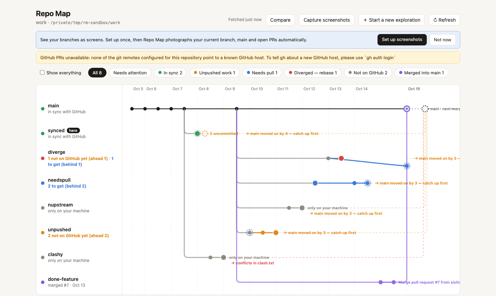

# Repo Map

A local web app that shows a git repo's branches, PRs and **screens** as a graph, compares local vs GitHub, and helps you push, pull and rebase safely. Built for people who think in screens, not diffs — and every action shows the raw git command, so you learn git as you go.



## Why

`git log --graph` tells you what happened. It doesn't tell you where you *are*. Repo Map answers the questions you actually have:

- **What's only on my machine?** Orange dots exist locally, blue only on GitHub, grey are shared.
- **Will this branch merge cleanly?** Each open branch shows whether it's clean, behind main, or would conflict.
- **What did this branch change, visually?** Screenshots of every route per branch, with a pixel diff between any two points, no Percy or Chromatic setup.
- **Is it safe to click?** Every action shows the exact git command first and waits for you. It never force-pushes, auto-stashes uncommitted work, and pauses on conflicts.

It's especially handy when AI agents create lots of branches and worktrees and you want to see what they did without reading 40 files.

## Install

```bash
cd your-repo && npx github:sistla234/repo-map
```

Or install it once with `npm install -g github:sistla234/repo-map` and run `repo-map` in any repo.

### As a Claude Code skill

```bash
mkdir -p ~/.claude/skills/repo-map && cp skill/SKILL.md ~/.claude/skills/repo-map/
```

Then say "repo map" in any repo.

## Setup (from source)

Requires Node 18+, git, and the [GitHub CLI](https://cli.github.com) logged in (`gh auth login`) for PRs.

```bash
cd repo-map
npm install
npm run build          # builds the UI once
node bin/repo-map.js /path/to/your/repo     # defaults to the current directory
```

Opens at `http://localhost:4747` (next free port if busy). Running it again for the same repo reuses the running server.
`node bin/repo-map.js <repo> --status` prints a plain-text summary and recommended next step without starting the UI.
A Claude Code skill (`~/.claude/skills/repo-map`) wraps all of this: say "repo map" in a repo.

Try it safely first: `scripts/make-sandbox.sh && node bin/repo-map.js /tmp/rm-sandbox/work` builds a throwaway repo with one branch in every state.

## What you see

- **Graph** — time runs left to right. `main` is the trunk; branches fork off the commit they started from. Orange dots exist only on your machine, blue dots only on GitHub, grey are shared. Merged PRs are purple loops back into main; open branches have a dashed line to “next merge”, coloured by whether it would merge cleanly, is behind main, or would conflict. Stale and bot branches are hidden unless you tick *Show everything*.
- **Actions** (select a branch): Share my work (`git push`), Get teammates' changes (`git pull --ff-only`), Catch up with main (`git fetch && git rebase`), Open a PR (`gh pr create`), Start a new exploration (`git switch -c`). Each shows the exact commands, the commits and files involved, and waits for you to confirm. Never force-pushes; auto-stashes uncommitted work; pauses on conflicts. Every command is logged in the History panel and in `~/.repo-map/history/`.
- **Screenshots** — thumbnails of each branch tip on the graph, and a strip of every captured route in the branch's detail panel.
- **Compare** — pick any two points (your copy vs GitHub, branch vs main, PR vs base, any two commits). *Screens* shows side-by-side or an overlay with changed pixels highlighted and a % changed per route; *Files* shows the file diff.

## Screenshots: `.repo-map.json`

Put this in your repo root (or let Repo Map detect settings from `package.json` and ask you to confirm — it writes the file when you click Save):

```json
{
  "mode": "build",
  "install": "npm ci",
  "build": "npm run build",
  "outDir": "dist",
  "port": 5173,
  "routes": ["/", "/settings", { "path": "/reports", "name": "Reports", "waitFor": "[data-ready]" }],
  "viewport": { "width": 1440, "height": 900 },
  "waitMs": 500,
  "fullPage": false,
  "env": { "VITE_API_URL": "http://localhost:0" }
}
```

| Field | Meaning |
|---|---|
| `mode` | `"build"` builds then serves `outDir` (steadier, recommended) or `"dev"` runs your dev server. |
| `install` | Only used when a commit's lockfile differs from your checkout; otherwise your `node_modules` is reused (symlinked). |
| `build` / `outDir` | Build command and its output folder (build mode). |
| `dev` | Dev command for dev mode; `{port}` is replaced with a free port, e.g. `npm run dev -- --port {port} --strictPort`. |
| `routes` | Paths to photograph. Strings, or `{ path, name, waitFor }` where `waitFor` is a CSS selector to wait for. |
| `viewport`, `fullPage`, `waitMs` | Screenshot size, whole page vs first screen, extra settle time. Animations are switched off. |
| `env` | Extra environment variables for install/build/dev (e.g. `{ "VITE_NO_ENTRA_LOGIN": "true" }`). |
| `storage` | `{ localStorage: {...}, sessionStorage: {...} }` set before each page loads, to dismiss first-run modals. |

How it renders: each commit is checked out into a temporary **git worktree** (in your OS temp folder), built, served on a free localhost port, photographed with Playwright, and the worktree is deleted. Your working tree is never touched. Results are cached by commit SHA in `~/.repo-map/cache/<repo-name>/<sha>/`, so re-opening is instant; changing routes or viewport re-captures.

Limits: prototypes that need a real backend/login will render their logged-out or error state. Monorepos with per-package `node_modules` may need a custom `install`. Playwright uses its bundled Chromium if installed, otherwise Google Chrome; if neither exists run `npx playwright-core install chromium`.

### Reliable capture (what it checks and fixes for you)

Capture never reports success for a blank page. After each route it checks for uncaught page errors, JS/CSS files that 404 or come back as HTML, and screenshots that are >99% one colour or tiny. A route that fails shows the reason in the UI (`blank: Missing Entra authentication environment variables`) and the job says “9 of 12 routes OK — 3 blank”, never “Captured 12/12”. Console errors alone are shown as warnings unless the page is also blank.

- **Missing env vars.** A fresh worktree has no gitignored `.env.local`. Repo Map never copies real secret files. Instead it looks for `.env.no-auth`, `.env.test` and `.env.example` (secret-looking names are left out), and for login-bypass switches the code reads (e.g. `VITE_NO_ENTRA_LOGIN`). They're offered in the setup form, and if a capture fails with a “missing env” error you get a one-click “Add VITE_… to the config and re-capture” button. Variables live in `"env"` in `.repo-map.json`.
- **Base path.** For Vite builds with `base: './'` Repo Map builds with `--base=/` for captures; for a non-root base like `/app/` it serves the build under that path. The static server also resolves relative asset URLs from deep routes. The failed-asset check verifies the result.
- **Routes.** Detected from your router (`<Route path>`, nested routes joined, `createBrowserRouter` objects). Redirects (`<Navigate>`, `*Redirect` components), `:param` and wildcard routes, and routes rendering the exact same element as an earlier one are skipped (and listed with the reason, unchecked). Choose routes and per-route `waitFor` selectors in the form.
- **First-run modals.** Set `"storage": { "localStorage": { "onboarding-seen": "true" }, "sessionStorage": {} }` to pre-set browser storage before the page loads. The form suggests keys the code uses that look like tour/welcome flags.
- **`.repo-map.json` stays out of git status.** Saving adds it to `.git/info/exclude` (local to you) unless you untick the option, or it's already tracked.
- **Stale servers.** `/api/ping` and the footer show the version and when the server started. If the interface was rebuilt after the server started (or an `/api/shots/*` call returns HTML), a banner offers **Restart Repo Map**. `node bin/repo-map.js <repo> --restart` does the same from the terminal.

`npm test` runs `test/capture.test.mjs`: an auth-gated fixture app with `base: './'` must be reported blank (with the reason) when env is missing, and produce non-blank images on deep routes once configured.

### Automatic capture

Once `.repo-map.json` exists (that's your consent to run its build commands), Repo Map photographs branches **in the background** every time the map loads or refreshes. It picks your current branch, `main`, open PRs, and branches touched in the last 21 days (bots like Dependabot are skipped), newest-relevant first, skipping anything already cached.

- A chip in the header shows progress and has a pause button; click it for a live log of every command.
- A commit that fails (build error, dev server won't start) is attempted once, then left alone until you hit Re-capture or change the config.
- Manual captures jump the queue. Cache entries older than 30 days that no current branch needs are pruned.
- Tune or switch off in `.repo-map.json`: `"autoCapture": false`, `"autoMax": 8` (max new commits per refresh), `"autoDays": 21`.

## Safety

- Read before acting: loading the map only runs `git fetch --prune` and read-only git/gh commands.
- No force-push, `reset --hard`, `clean` or `branch -D` anywhere in the app.
- State-changing requests are accepted only as JSON from the app's own localhost origin, and the server re-plans and runs exactly the commands you were shown (it refuses if the repo changed in between).

## Layout

```
bin/repo-map.js       launcher (path arg, --status, --no-open, server reuse)
server/git.js         read-only repo data: branches, ahead/behind, graph, merge status
server/actions.js     intent planner + runner, rebase control, history
server/shots.js       .repo-map.json, worktree rendering, Playwright capture queue
server/compare.js     pixelmatch diffs, file diffs
server/summary.js     terminal summary
src/                  React UI (Graph, Actions, Shots, Compare)
scripts/make-sandbox.sh
```

## License

MIT
